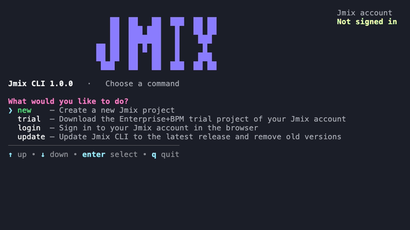

# Jmix CLI

[](https://github.com/jmix-framework/jmix-cli/actions/workflows/ci.yml)
[](LICENSE)

Create [Jmix](https://www.jmix.io/) projects from the same templates as Jmix Studio.

Use the interactive wizard or run the CLI from a script or an AI agent.



## Install

**macOS / Linux**

```bash
curl -fsSL https://github.com/jmix-framework/jmix-cli/releases/latest/download/install.sh | bash
```

**Windows (PowerShell)**

```powershell
irm https://github.com/jmix-framework/jmix-cli/releases/latest/download/install.ps1 | iex
```

The installer opens the command menu. On macOS and Linux, open a new terminal
after installation so your shell can find `jmix`. See the
[distribution guide](docs/DISTRIBUTION.md) for other installation options.

## Create a project

Run `jmix` to open the command menu or `jmix new` to go straight to the wizard.
Choose a template, languages, and add-ons. From a script, generate a project
with `--non-interactive`.

```shell
jmix new demo --non-interactive
cd demo
./gradlew bootRun
```

On Windows, use `.\gradlew.bat bootRun`. The CLI bundles Java, but building the
generated app requires a compatible JDK. The wizard can help install one.

Run `jmix new --help` for options such as `--jmix-version`, `--template`, and
`--addons`. See [wizard controls](docs/features/wizard.md),
[project generation](docs/features/project-generation.md), and
[commercial add-on setup](docs/features/add-ons.md#commercial-add-ons).

## Agent Toolkit

New projects include Agent Toolkit guidelines and skills. The Toolkit
configures JetBrains and Playwright MCP servers for Codex, Claude Code, and
OpenCode. Use `--no-agents-toolkit` to skip setup. See the
[Agent Toolkit guide](docs/features/environment-and-toolkit.md).

## Jmix account and trial

Sign in to download the Enterprise+BPM trial project.

```shell
jmix login
jmix trial
```

Use `jmix login --region ru` for a jmix.ru account. See the
[account and trial guide](docs/features/account-and-trial.md) for activation
and scripting options.

## Update

Installed builds check for updates automatically. Run `jmix update` to update
on demand. See the [update guide](docs/features/updates.md).

## Development

Use JDK 17 or newer to launch Gradle. The build provisions a JDK 25 toolchain.

```bash
./run.sh        # Run from source on macOS or Linux
./gradlew build # Build and test
```

See the [contributor guide](AGENTS.md) for verification and feature docs.

## License

[Apache License 2.0](LICENSE).
